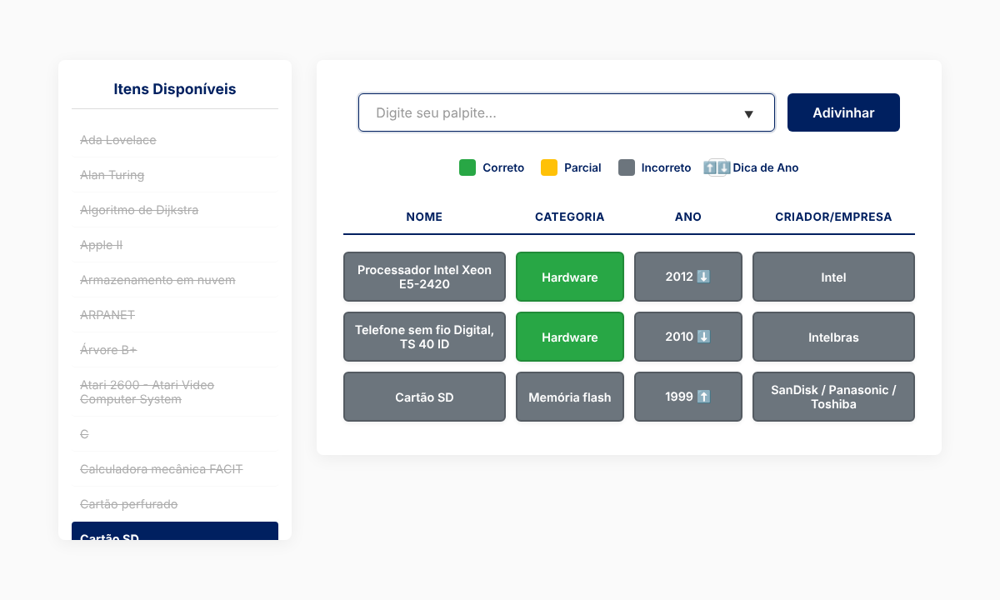
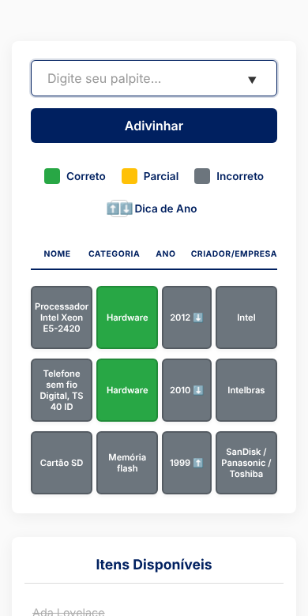

# MuseuDle

Jogo diário de adivinhação sobre a história da computação, criado para o **Museu da Computação da UFU** como projeto de extensão da Universidade Federal de Uberlândia.

Todo dia o jogo sorteia um artefato (uma pessoa, um computador, uma linguagem, um sistema operacional...) e o jogador tem que descobrir qual é, usando dicas de categoria, ano e criador.

**[▶ Jogar agora](https://andrenc1.github.io/museudle/)**

<p align="center">
  
</p>

## Como jogar

1. Digite o nome de um artefato ou clique em um item da lista **Itens Disponíveis**.
2. Cada palpite mostra uma linha com quatro dicas:

| Cor | Significado |
|---|---|
| 🟩 Verde | O atributo é igual ao do artefato do dia |
| 🟨 Amarelo | Acerto parcial: o criador ou a empresa tem um nome em comum |
| ⬜ Cinza | O atributo é diferente |
| ⬆️ ⬇️ | O artefato do dia é mais novo ⬆️ ou mais antigo ⬇️ que o seu palpite |

3. A lista lateral risca automaticamente os itens que já não podem ser a resposta, com base nas dicas recebidas.
4. Ao acertar, o botão **Saiba Mais** mostra os dados do artefato e o link para o acervo digital do museu ou para uma fonte sobre ele.
5. Um novo artefato aparece à meia-noite (horário do seu computador).

## Funcionalidades

- **52 artefatos** da história da computação, de Ada Lovelace ao armazenamento em nuvem, vários deles com link para o [acervo digital do Museu da Computação](https://tainacan.facom.ufu.br/)
- **Mesmo desafio para todos os jogadores** no mesmo dia, sem precisar de servidor
- **Progresso salvo no navegador:** recarregar a página não apaga os palpites do dia
- **Filtro de eliminação** que risca os itens incompatíveis com as dicas
- **Layout responsivo**, pensado também para o celular
- Feito com **JavaScript puro**, sem frameworks nem bibliotecas

<p align="center">
  
</p>

## Como funciona

**Escolha do artefato do dia.** A data local (`AAAA-MM-DD`) passa por uma função de hash e vira a semente de um gerador pseudoaleatório (Mulberry32). Como a semente é a mesma para todos no mesmo dia, todos recebem o mesmo artefato, e isso é calculado no próprio navegador.

```js
const rng = getSeededRandom(getTodayString()); // ex.: "2026-10-19"
dailyItem = itens[Math.floor(rng() * itens.length)];
```

**Dicas.** Cada palpite é comparado com o artefato do dia em quatro atributos. O criador conta como acerto parcial quando os dois compartilham um nome (os nomes são separados por `/`, como em `Sony / Philips`).

**Filtro de eliminação.** Depois de cada palpite, o jogo percorre todos os itens e risca os que contradizem alguma dica já recebida: categoria errada, ano fora do intervalo possível ou criador diferente quando o criador já foi acertado.

**Progresso.** Os palpites do dia ficam no `localStorage` do navegador. No dia seguinte, o progresso antigo é descartado.

## Estrutura do projeto

```
museudle/
├── index.html        # Estrutura da página
├── css/
│   └── style.css     # Estilos e layout responsivo
├── js/
│   ├── itens.js      # Lista de artefatos do jogo
│   └── script.js     # Lógica do jogo
└── docs/             # Imagens usadas neste README
```

Os artefatos ficam em um arquivo `.js`, e não em um `.json`, para que o jogo funcione abrindo o `index.html` direto no computador: navegadores bloqueiam o carregamento de arquivos JSON locais por `file://`.

## Como rodar localmente

Não precisa instalar nada.

```bash
git clone https://github.com/andrenc1/museudle.git
cd museudle
```

Depois, abra o arquivo `index.html` no navegador.

## Como adicionar um artefato

Inclua um objeto novo na lista em `js/itens.js`:

```js
{
  "Nome": "Commodore 64",
  "Categoria": "Microcomputador",
  "Ano": 1982,
  "Criador/Empresa": "Commodore",
  "Link": "https://link-para-saber-mais"
}
```

- **Categoria:** use uma categoria que já exista, para que a dica de categoria funcione bem.
- **Criador/Empresa:** separe vários nomes com ` / `, que é o que permite o acerto parcial. Use `N/A` quando não se aplicar.
- **Link:** se o item estiver no acervo do museu, use o link do Tainacan; o botão passa a mostrar **Ver no Acervo**.

## Próximos passos

- Estatísticas do jogador (vitórias e sequência de dias)
- Botão para compartilhar o resultado do dia
- Mais artefatos do acervo do museu

## Créditos

Desenvolvido por [André Noro Crivellenti](https://www.linkedin.com/in/andre-noro/) para o Museu da Computação da Faculdade de Computação (FACOM) da Universidade Federal de Uberlândia.
